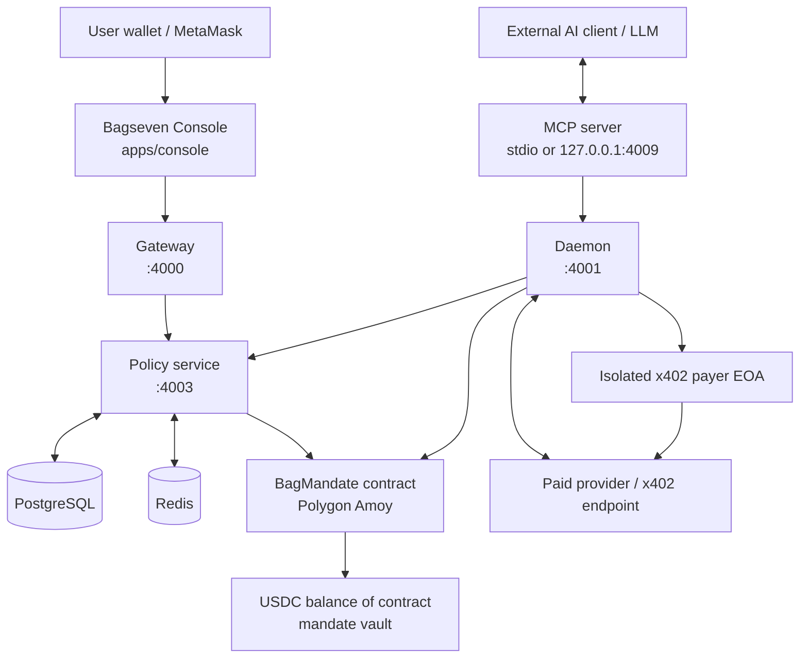
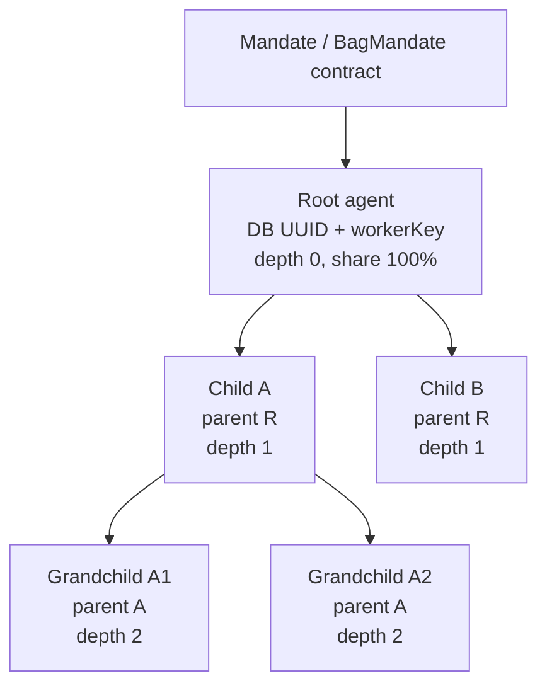
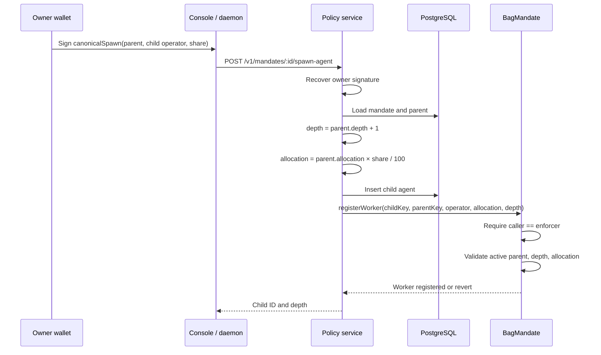
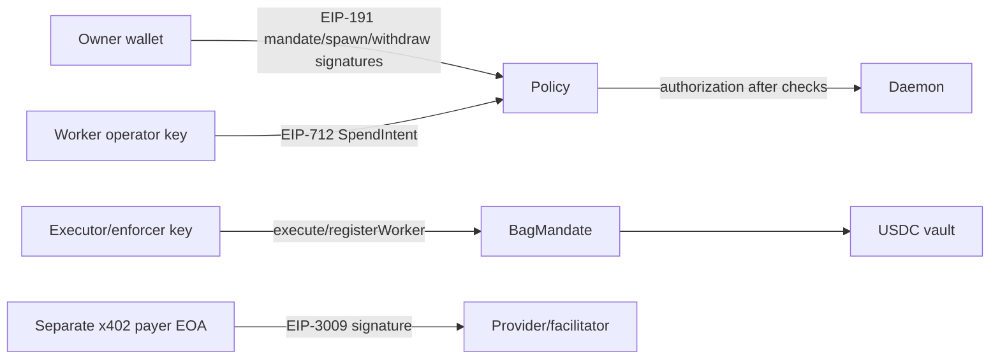

# Bagseven Agent Architecture Audit

Audit scope: repository state inspected on 2026-10-14. This document describes the implementation found in source code and tests. It does not treat UI copy or planned documentation as proof that a feature works.

## 1. Executive summary

Bagseven is a worker-bound spending-control system. A user signs an immutable mandate in a wallet. The policy service deploys a `BagMandate` contract and creates a database root agent. A child agent is an off-chain database record plus an on-chain worker registered under a parent worker. The worker tree contains operator addresses, parent links, allocations, spend counters, depth, and active state.

The contract is the final spending authority. The policy service performs signature verification, nonce replay protection, database reservation, and an on-chain pre-check. The daemon signs an EIP-712 spend intent with the configured worker operator key. In daemon-executor mode, the policy service returns an authorization and reservation; the daemon submits `BagMandate.execute()` using the configured enforcer/executor key and settles the reservation.

The MCP server is an adapter, not a policy engine. It is bound to one worker when started with `BAGSEVEN_MCP_WORKER`. Its tools forward status, fetch, and spawn requests to the daemon. The LLM sees tools, but not private keys.

The main verified limitations are:

- The local MCP is worker-bound by process configuration, not automatically mapped to an external agent identity.
- OAuth, user accounts, remote hosted MCP, and automatic external-agent provisioning were not found.
- The database child row is inserted before on-chain worker registration. If registration fails, the route returns an error but does not visibly delete the inserted row; this can create a database/on-chain inconsistency.
- x402 v2 parsing and an isolated payer EIP-3009 signature adapter exist, but successful settlement depends on the provider/facilitator accepting that payment model and on a separately funded payer EOA. The existing BagMandate vault itself cannot produce EIP-3009 authorization.
- The repository contains automated contract, x402, configuration, and scripted E2E coverage, but this audit did not claim a live Polygon Amoy payment without execution evidence.

Status vocabulary used below:

- **IMPLEMENTED AND VERIFIED** — source plus relevant automated or execution evidence.
- **IMPLEMENTED, NOT FULLY VERIFIED** — source exists, but live or complete evidence is missing.
- **PARTIALLY IMPLEMENTED** — only part of the requested behavior exists.
- **NOT IMPLEMENTED** — no implementation found.
- **UNABLE TO CONFIRM** — available source/evidence is insufficient.

## 2. Repository structure

| Area | Relevant files | Responsibility |
|---|---|---|
| Contract | `packages/contracts/src/BagMandate.sol` | Vault, mandate caps, worker tree, on-chain checks, execution |
| Contract tests | `packages/contracts/test/BagMandate.t.sol` | Foundry tests for contract behavior |
| On-chain client | `packages/onchain/src/index.ts`, `abi.ts`, `bytecode.ts` | viem deployment, reads, writes, signature helpers, worker IDs |
| Database | `packages/db/src/schema/bagseven.ts`, `client.ts`, `drizzle/*.sql` | Mandates, agents, vault mirrors, reservations, refusals, transactions, providers |
| Money | `packages/money/src/index.ts` | Decimal validation and USDC micro-unit conversion |
| HTTP platform | `packages/server/src/service.ts`, `errors.ts`, `idempotency.ts`, `rateLimit.ts` | Fastify service/error/idempotency/rate-limit primitives |
| Gateway | `services/gateway/src/index.ts` | Browser/API proxy to Policy |
| Policy | `services/policy/src/routes.ts` | Mandate lifecycle, worker resolution, signatures, checks, reservations, reconciliation |
| Daemon | `services/daemon/src/index.ts` | MCP-facing status/fetch/spawn, operator signing, executor transaction, x402 flow |
| x402 | `services/daemon/src/x402.ts`, `x402-payer.ts` | x402 v2 requirement validation and isolated EOA payer |
| MCP | `scripts/bagseven-mcp.ts` | stdio/HTTP MCP server and four registered tools |
| Demo agent | `apps/research-demo/src/agent.ts`, `index.ts` | Real OpenAI-compatible LLM tool loop and research UI/API |
| Console | `apps/console/app/page.tsx`, `components/dashboard/sections.tsx`, `lib/client.ts`, `lib/wallet.ts` | Wallet UX, mandates, agents, vault, MCP connection configuration |
| E2E scripts | `scripts/e2e-tree.ts`, `scripts/e2e-bagseven.ts`, `scripts/mcp-smoke.ts` | Local/Polygon-oriented scripted tests |

## 3. Actual system architecture



Important boundaries:

- The browser never receives the daemon operator, executor, owner, or x402 payer private key.
- The MCP process receives a worker ID and routing settings. It does not receive a private key.
- The operator signs the spend intent off-chain.
- The executor/enforcer submits `execute()` on-chain.
- The contract checks the final limits again, even if the off-chain policy check allowed the request.

## 4. Mandate lifecycle

### 4.1 Creation

The console collects owner address, operator address, caps, chain ID, and an owner EIP-191 signature. `MandateSection` in `apps/console/components/dashboard/sections.tsx` constructs the canonical mandate payload and calls `Client.createMandate()`.

`POST /v1/mandates` in `services/policy/src/routes.ts`:

1. Validates the request with `createMandateSchema`.
2. Validates money strings.
3. Rebuilds the canonical payload with `canonicalMandate()`.
4. Recovers the EIP-191 signer and requires it to equal `owner_address`.
5. Deploys `BagMandate` through `MandateClient.deploy()`.
6. Uses `DAEMON_EXECUTOR_ADDRESS` as the contract enforcer when configured.
7. Inserts the mandate, vault mirror, and root agent in a database transaction.

The root agent is automatically created. It is not a later separate operation.

### 4.2 On-chain state created

The constructor stores immutable values:

- `owner`
- root `operator`
- `enforcer`
- USDC token
- window budget and duration
- lifetime cap
- per-purchase cap
- seller percentage
- maximum depth
- root worker key and allocation

The contract’s `workers[rootWorker_]` entry is active, depth `0`, parent `bytes32(0)`, and allocation `rootAllocation_` (the route uses the lifetime cap).

### 4.3 Funding

The vault is not a separate smart-contract type. It is the USDC balance held by the BagMandate contract, returned by `vaultBalance()`.

The console wallet flow in `apps/console/lib/wallet.ts`:

1. Requires Polygon Amoy.
2. Reads the connected wallet’s USDC balance.
3. Sends USDC `approve(contract, amount)`.
4. Waits for approval.
5. Sends `BagMandate.fund(amount)`.
6. Waits for the funding transaction.

The policy route also has `/v1/vaults/:mandateId/fund`, which uses the configured policy/enforcer-side client and records a `fund` transaction. The console generally funds directly from the connected wallet.

### 4.4 Withdrawal and revocation

The contract exposes owner-only `withdraw()` and `withdrawToken()` and owner-only `revoke()`. The console has owner-signed withdrawal flows. A general policy route for owner withdrawal exists at `/v1/vaults/:mandateId/withdraw` and verifies the canonical withdrawal signature.

The source exposes `MandateClient.revoke()` and the contract exposes `revoke()`, but a complete console/policy revoke workflow was not found in the inspected route set. Agent status values (`active`, `suspended`, `retired`) exist in the database, while the contract has `setWorkerActive()` for owner-controlled worker activation. A complete user-facing synchronization path for worker revocation was not confirmed.

## 5. Root agent and child hierarchy

### 5.1 Concepts

| Concept | Meaning in this codebase |
|---|---|
| Mandate | One signed spending policy and one deployed `BagMandate` contract/vault |
| Root agent | Automatically-created depth-0 database agent and root on-chain worker |
| Child agent | Database agent row plus on-chain worker registered under a parent worker |
| Worker | On-chain `bytes32` identifier derived from the database agent UUID with `workerKey()` |
| Operator | EVM address whose key signs that worker’s EIP-712 spend intent |
| Owner | Wallet that signed/created the mandate and can fund, withdraw, revoke, and authorize child spawning |
| Enforcer/executor | Backend address allowed by the contract to call `execute()` and `registerWorker()` |
| LLM agent | External reasoning process using MCP tools; not itself an on-chain role |
| Vault | USDC held by the BagMandate contract address |

### 5.2 Hierarchy representation



The database stores `parentAgentId`, `depth`, `sharePercent`, and `allocation`. The contract stores the equivalent worker parent, depth, allocation, spent, and active values in `mapping(bytes32 => Worker)`.

### 5.3 Child spawning

`POST /v1/mandates/:id/spawn-agent` in `services/policy/src/routes.ts`:

1. Validates parent UUID, child operator address, share percentage, chain, and signature.
2. Loads the parent and verifies it belongs to the selected mandate.
3. Reconstructs `canonicalSpawn()`.
4. Requires the recovered signer to equal the mandate owner.
5. Calculates `depth = parent.depth + 1`.
6. Rejects depth over `mandate.maxDepth`.
7. Calculates `allocation = parent.allocation * share_percent / 100`.
8. Inserts the child database row.
9. Calls `registerWorker(workerKey(child.id), workerKey(parent.id), operator, allocation, depth)` on-chain.

The daemon’s `bagseven_spawn` tool can call `/internal/workers/:worker/spawn`; the daemon signs the canonical spawn payload with its configured owner key after confirming the owner matches the resolved mandate.

### 5.4 Allocation behavior

Allocation is percentage-based and recursive.

Example:

```text
Root allocation = $100
Child A = 50% of root = $50
Child B = 25% of root = $25
Grandchild A1 = 50% of Child A = $25
```

The contract does not require sibling percentages to sum to 100%. Therefore `$50 + $25` does not create a separately tracked `$25` remainder; the remainder is simply unused parent capacity. Child allocations can overlap conceptually, but each child’s own spend and every ancestor’s spend must remain within that worker’s allocation. A child’s allocation is not automatically returned or rebalanced when it spends less.

On-chain `registerWorker()` rejects a child allocation greater than the parent’s remaining allocation at registration time. `checkWorker()` then checks the requested amount against every worker from the child through the root. `_execute()` increments `spent` on every worker in that path.

### 5.5 Allocation and registration consistency gap

The policy route inserts the child into PostgreSQL before calling `registerWorker()`. If the chain call fails, the route returns `WORKER_CHAIN_REGISTRATION_FAILED`, but no compensating delete is visible in the source. The database may then show an active child that does not exist on-chain. This is **PARTIALLY IMPLEMENTED** reconciliation and should be addressed with an outbox/state machine or a compensating transaction.

## 6. Child spawning and allocation diagram



## 7. Complete spending flow

### 7.1 Direct amount/recipient request

```mermaid
sequenceDiagram
    participant A as LLM / external MCP client
    participant M as Bagseven MCP
    participant D as Daemon
    participant P as Policy
    participant R as Redis/Postgres
    participant B as BagMandate
    participant V as USDC vault

    A->>M: bagseven_fetch(amount, recipient)
    M->>D: POST /internal/workers/{boundWorker}/fetch
    D->>P: GET /v1/resolve?ref=worker
    P-->>D: agent, mandate, remaining limits
    D->>D: Require active worker and active mandate
    D->>D: Sign EIP-712 SpendIntent with operator key
    D->>P: POST /v1/spend-intents
    P->>P: Recover signer and compare agent.operatorAddress
    P->>R: SET nonce NX; reserve request
    P->>B: eth_call checkWorker(amount, recipient, workerKey)
    B-->>P: Allow/refusal code
    P-->>D: Reservation + authorization, or refusal
    D->>B: execute(amount, recipient, workerKey) as enforcer
    B->>B: Re-check limits; increment worker ancestors
    B->>V: USDC transfer(recipient, amount)
    D->>P: POST /v1/reservations/{id}/settle
    P->>R: Mark settled, insert transaction, refresh mirrors
    D-->>M: tx hash, decision, remaining limits
    M-->>A: Tool result
```

### 7.2 Exact functions and routes

1. MCP registers `bagseven_fetch` in `scripts/bagseven-mcp.ts`.
2. MCP forwards to daemon `POST /internal/workers/:worker/fetch`.
3. Daemon calls `resolveWorker()` and Policy `GET /v1/resolve`.
4. Daemon’s `executeSpend()` signs `spendIntentDomain()` / `spendIntentTypes` from `packages/onchain/src/index.ts`.
5. Policy `/v1/spend-intents` calls `recoverSpendIntentSigner()`.
6. Policy calls `MandateClient.checkWorker()`.
7. Policy inserts a `reserved` row.
8. In executor mode, Policy returns authorization to the daemon.
9. Daemon calls `MandateClient.execute()` with `DAEMON_EXECUTOR_KEY`.
10. Policy settles the reservation and updates `transactions` and mirror counters.

The operator key does not call the chain. The enforcer/executor key calls the chain. This is why the contract’s immutable `enforcer` must match `DAEMON_EXECUTOR_ADDRESS`.

## 8. Spending limits and invariants

| Restriction | Source | Enforcement | Evidence/status |
|---|---|---|---|
| Mandate active/revoked | `BagMandate.sol:92-95, 204-220` | On-chain | Named `MandateInactive`; contract tests cover revoke behavior |
| Per-purchase cap | `BagMandate.sol:125-126` | On-chain; x402 pre-check also | `PerTxCapExceeded`; x402 tests cover policy pre-check |
| Rolling window budget | `BagMandate.sol:113-119, 127-129` | On-chain | `DailyCapExceeded`; contract tests |
| Lifetime cap | `BagMandate.sol:130` | On-chain | `LifetimeCapExceeded`; contract tests |
| Seller cap | `BagMandate.sol:131-133` | On-chain | `PerSellerCapExceeded`; contract tests |
| Vault balance | `BagMandate.sol:135-136` | On-chain | `VaultInsufficient`; funding and balance tests |
| Maximum depth | `BagMandate.sol:134`, `registerWorker()` | On-chain and DB pre-check | `DepthExceeded`; `scripts/e2e-tree.ts` tests depth 4 refusal |
| Worker active | `checkWorker()` | On-chain; daemon/policy checks status too | `WorkerInactive`; contract test coverage exists |
| Worker allocation | `checkWorker()` ancestor loop | On-chain | `WorkerAllocationExceeded`; hierarchy tests |
| Parent allocation at registration | `registerWorker()` | On-chain | `InvalidWorkerParent`; tree E2E exercises registration |
| Owner authorization | policy EIP-191 recovery and contract `onlyOwner` | Both | `SIGNATURE_MISMATCH` / `Unauthorized` |
| Enforcer authorization | contract `onlyEnforcer` | On-chain | `Unauthorized`; daemon checks executor address |
| Operator authorization | policy EIP-712 recovery | Off-chain before execute | `OPERATOR_MISMATCH`; daemon also checks configured key |
| Spend nonce replay | Redis `SET NX` in Policy | Off-chain | `NONCE_REUSED`; 24-hour TTL |
| Signature timestamp | Policy `SPEND_INTENT_MAX_AGE_SECONDS` | Off-chain | `SPEND_INTENT_EXPIRED` |
| HTTP idempotency | `packages/server/src/idempotency.ts` | Off-chain | Same key returns cached result; 5xx not cached |
| Rate limit | `packages/server/src/rateLimit.ts` | Off-chain Redis Lua | 429 rate limit |
| x402 version/network/token | `services/daemon/src/x402.ts` | Off-chain before signing | x402 tests cover unsupported network/token/recipient |

The contract’s `checkWorker()` and `_execute()` both check the ancestor chain, so the final transaction cannot rely only on the policy service’s pre-check.

## 9. MCP and external agent integration

### 9.1 MCP transports and binding

`scripts/bagseven-mcp.ts` supports:

- stdio when `BAGSEVEN_MCP_PORT` is absent;
- local Streamable HTTP at `http://127.0.0.1:${BAGSEVEN_MCP_PORT}/v1/mcp` when the port is set.

Startup requires `BAGSEVEN_MCP_WORKER`. The process refuses to start without it. Every tool request uses that process-level worker; the tool schema does not accept a worker selector.

HTTP POST can require `MCP_AUTH_TOKEN`. The GET health response is local and returns `{ ok, service, worker }`; it is not a payment authorization endpoint.

### 9.2 Registered tools

| Tool | Input | Path |
|---|---|---|
| `bagseven_status` | none | MCP → daemon status → Policy `/v1/resolve` |
| `bagseven_search` | `query` | MCP → configured research provider `/v1/providers` |
| `bagseven_fetch` | `url` or `amount` + `recipient`, optional reason | MCP → daemon fetch → policy/payment/provider |
| `bagseven_spawn` | mandate ID, parent ID, operator address, share | MCP → daemon spawn → owner-signed Policy spawn route |

The MCP server contains no wallet or policy logic. The daemon contains the worker lookup, operator signature, provider challenge processing, and execution orchestration.

### 9.3 External agent association

The current association is:

```text
MCP process environment
  BAGSEVEN_MCP_WORKER=<database agent UUID>
        ↓
Daemon /internal/workers/<UUID>/...
        ↓
Policy resolves UUID to agent → mandate → contract
```

An external LLM cannot choose another worker through a tool argument. To change workers, the operator must start another MCP process or restart the process with another binding. There is no OAuth-based user identity or automatic external-agent account mapping in the inspected implementation.

The console can generate local MCP and Claude Desktop configuration in `apps/console/lib/mcp.ts` and `mcp-connection.tsx`. The generated configuration contains routing settings and a worker ID, not private keys. Claude Desktop integration is configuration generation plus local stdio support; a real Claude Desktop launch was not verified by repository tests.

## 10. LLM and research demo

`apps/research-demo/src/agent.ts` uses an OpenAI-compatible chat-completions endpoint configured through Cline/OpenCode/OpenAI-compatible environment variables. It uses the official MCP client `StreamableHTTPClientTransport`, lists tools, converts them to model tool definitions, runs up to eight model turns, and forwards tool calls to MCP.

The system prompt requires `bagseven_status` before payment work and says not to fabricate hashes or retry failed fetches. This is agent behavior, not the security boundary; the daemon, Policy service, and contract enforce the actual authorization.

The demo is a real LLM loop when an API key is configured. It is not proof that every provider/model works, and it does not make payment succeed if the worker, vault, executor, x402 payer, or provider is misconfigured.

## 11. x402 payment flow

### Legacy/provider challenge path

The daemon fetches the provider URL. If it receives HTTP 402, it parses the challenge, validates provider hostname, expiry, chain, token, recipient, provider registration, and provider signature, then passes the derived amount/recipient into the normal Bagseven spend flow. After settlement it retries the provider with the legacy `x-payment` / `x-payment-response` headers.

### x402 v2 path

`services/daemon/src/x402.ts` accepts x402 version 2, exact scheme, `eip155:80002`, configured USDC, valid recipient, positive atomic amount, and timeout. It checks the amount against per-purchase, window, lifetime, and vault limits before reservation/signing.

`services/daemon/src/x402-payer.ts` creates an EIP-3009 `TransferWithAuthorization` signature from `BAGSEVEN_X402_PAYER_KEY`. The payer is intentionally a separate EOA and must not equal the worker operator or contract enforcer. It is not the BagMandate vault.

The daemon then:

1. reserves and executes the Bagseven-controlled spend;
2. creates the x402 payment header;
3. retries the provider with `PAYMENT-SIGNATURE`;
4. refunds the isolated payer to the mandate contract on provider rejection where possible;
5. releases the reservation on failure.

This architecture currently requires the payer EOA to be funded and the provider/facilitator to accept the x402 v2 signature. `assertVaultSupportsEip3009()` explicitly fails closed because the BagMandate vault cannot itself produce `transferWithAuthorization`.

## 12. Database and on-chain state mapping

| Database table | Important fields | On-chain equivalent | Authority |
|---|---|---|---|
| `mandates` | IDs, owner/operator, contract, caps, status, mirror counters | BagMandate immutable caps, status, counters | Contract for spending; DB for application lookup/mirror |
| `agents` | UUID, mandate, parent UUID, operator, share, allocation, depth, status, metadata | `workers[workerKey(uuid)]` | Contract for spend authorization; DB for UI/lookup |
| `vaults` | mandate and contract address | ERC-20 balance of contract | Chain |
| `reservations` | mandate, agent, amount, status, expiry | No direct contract record | DB workflow record |
| `refusals` | mandate, agent, amount, seller, bound, reason | Named contract refusal code mirrored off-chain | DB audit record |
| `transactions` | mandate, agent, hash, amount, type | Transaction/event on chain | Chain transaction is authoritative; DB audit mirror |
| `providers` | hostname, signing address, status | No direct contract equivalent | DB/provider registry |

`workerKey()` derives a deterministic bytes32 worker key from the database agent identifier. The DB UUID and the on-chain worker key are related, but they are not the same value.

The DB does not automatically discover all chain workers. It relies on route-created records and explicit reconciliation after settlement. This is the main source of possible DB/chain divergence.

## 13. Security and signing model



The LLM receives MCP tool schemas and results. It does not receive the private keys. The generated local/Claude configuration also intentionally excludes keys and internal service tokens.

Current local configuration uses separate roles conceptually:

- `DAEMON_OPERATOR_KEY`: signs worker spend intents; it must derive to the selected worker operator.
- `DAEMON_EXECUTOR_KEY`: signs/submits chain transactions as the contract enforcer.
- `DAEMON_EXECUTOR_ADDRESS`: must equal the enforcer embedded in the deployed contract.
- owner key: signs owner operations; local compatibility names include `OWNER_DEV_KEY`.
- `BAGSEVEN_X402_PAYER_KEY`: separate payer EOA for x402 v2.

Production custody/HSM/MPC/smart-account support was not found; local environment keys are not a production custody design.

## 14. Failure handling and concurrency

### Implemented behavior

- Invalid mandate/child/operator input is rejected by Zod and route checks.
- Bad owner/operator signatures are rejected.
- Inactive mandate/worker is rejected.
- Contract bounds are checked off-chain and on-chain.
- Reused spend nonces are rejected with Redis `NX`.
- HTTP idempotency keys prevent duplicate API processing while a request is in progress and replay the completed response.
- A daemon executor failure attempts to release the reservation.
- x402 provider failure attempts refund plus reservation release.
- x402 challenge replay uses a Redis key with expiry.
- Provider/network/token/recipient mismatches fail closed.

### Important incomplete or unverified cases

1. **Child registration failure:** DB insert occurs before chain registration; compensation is not visible.
2. **On-chain success, DB settlement failure:** the daemon attempts settlement after `execute()`, but a database outage can leave an on-chain spend and a reserved DB row. A reconciliation worker was not found.
3. **Stuck reservations:** reservations have `expiresAt`; an automatic reservation-expiry job/reconciliation process was not confirmed in the inspected source.
4. **Concurrent sibling allocation:** the contract’s sequential transaction state and ancestor checks are authoritative. The off-chain reservation layer is not itself the final concurrency authority; calls race safely only if the chain transaction is the final gate.
5. **Provider timeout after payment:** x402 flow attempts refund, but recovery depends on the payer having authority/balance and provider/facilitator behavior. A durable settlement state machine was not found.
6. **Worker status synchronization:** database statuses and contract active flags can diverge unless an owner action updates both.
7. **Mandate expiration:** there is a time-based spending window, but no separate mandate expiration timestamp was found. Lifetime cap/revoke are the closure mechanisms.

## 15. Test coverage and verified behavior

### Found in repository

- Foundry contract tests: `packages/contracts/test/BagMandate.t.sol`.
- Tree script: `scripts/e2e-tree.ts` creates root, children, grandchildren, tests depth refusal, spends, resolves, and withdraws.
- General E2E script: `scripts/e2e-bagseven.ts`.
- x402 parsing/policy tests: `services/daemon/src/x402.test.ts`.
- x402 payer signature tests: `services/daemon/src/x402-payer.test.ts`.
- MCP configuration tests: `scripts/mcp-config.test.ts`.
- Money arithmetic tests: `packages/money/src/index.test.ts`.

### Evidence classification

| Behavior | Status | Evidence |
|---|---|---|
| Root agent is created with mandate | IMPLEMENTED AND VERIFIED | `routes.ts:166-204`; tree script |
| Child hierarchy and depth | IMPLEMENTED AND VERIFIED | contract `registerWorker/checkWorker`; `e2e-tree.ts` |
| Ancestor allocation enforcement | IMPLEMENTED AND VERIFIED by source/tests | contract ancestor loop and named error |
| Operator signature verification | IMPLEMENTED AND VERIFIED by source/test paths | `recoverSpendIntentSigner`, policy route |
| MCP worker binding | IMPLEMENTED AND VERIFIED | MCP startup guard and config tests |
| Local HTTP/stdio MCP | IMPLEMENTED, NOT FULLY VERIFIED | MCP implementation and smoke/config scripts |
| Real LLM tool loop | IMPLEMENTED, NOT FULLY VERIFIED | research demo source; requires external provider |
| Live Polygon Amoy payment | IMPLEMENTED, NOT FULLY VERIFIED | scripts/config exist; no live evidence in this audit |
| Legacy signed provider challenge | IMPLEMENTED, NOT FULLY VERIFIED | daemon challenge verifier |
| x402 v2 parsing and isolated payer signature | IMPLEMENTED AND VERIFIED at unit level | x402 tests |
| Successful x402 v2 provider settlement | PARTIALLY IMPLEMENTED | provider/facilitator compatibility and funding required |
| Automatic DB/chain reconciliation | NOT IMPLEMENTED / unable to confirm | no reconciler found |
| OAuth/external identity mapping | NOT IMPLEMENTED | no OAuth/auth identity integration found |
| Public hosted MCP | NOT IMPLEMENTED by design | local transport/configuration only |

## 16. Implemented versus missing features

### Implemented

- Polygon Amoy BagMandate deployment and USDC vault model.
- Owner mandate signature verification.
- Automatic root agent creation.
- Recursive worker registration with parent/depth/allocation.
- On-chain ancestor spending checks.
- Database mandate/agent/reservation/refusal/transaction records.
- Worker-bound MCP tools: status, search, fetch, spawn.
- Operator EIP-712 spend intent verification.
- Executor/enforcer transaction submission.
- Redis nonce and API idempotency controls.
- Legacy provider challenge and x402 v2 validation paths.
- Local console mandate, vault, agent, and MCP configuration UI.

### Partially implemented

- x402 v2 settlement: isolated payer signature exists, but the BagMandate vault is not an EIP-3009 payer and provider/facilitator settlement must be compatible.
- Agent pause/revoke: contract primitives and DB statuses exist, but a complete synchronized user workflow was not confirmed.
- Reconciliation: settlement updates DB after chain execution, but durable recovery for every crash boundary is not present.
- External LLM integration: the research demo is real and MCP-based, but model/provider availability is external.
- Agent naming/MCP endpoint metadata: DB and console fields exist; they are metadata, not contract identity.

### Not implemented or not confirmed

- OAuth or user account authentication.
- Automatic mapping of Claude/OpenAI/Cursor identities to Bagseven workers.
- Public multi-tenant MCP hosting.
- HSM/MPC production key custody.
- Provider marketplace with complete registration/discovery/settlement lifecycle.
- Complete on-chain/database reconciliation daemon.
- Automatic reservation expiry and stuck-payment recovery worker.

## 17. Architecture gaps and recommendations

1. Make child creation transactional across DB and chain through a pending state/outbox. Mark the DB child `pending_registration`; finalize only after the chain receipt.
2. Add a reconciliation worker that consumes `Executed`, `Withdrawn`, and worker-registration receipts and repairs database mirrors.
3. Add explicit reservation states for `reserved`, `execution_submitted`, `settlement_pending`, `settled`, `released`, and `unknown`.
4. Add a unique/strong idempotency relation for transaction hashes and reservation settlement to prevent duplicate database commits.
5. Add owner-only synchronized worker pause/revoke routes that update DB after confirmed chain receipts.
6. Separate policy pre-check failures from RPC dependency failures in every route, with trace IDs and structured upstream details.
7. For production, replace environment private keys with managed custody and provide an authenticated worker provisioning flow.
8. For x402 v2, use a provider-supported facilitator or a vault-compatible settlement contract rather than treating an isolated payer EOA as the vault.
9. Add integration tests that run against a deterministic Anvil/Polygon Amoy fixture and verify chain events, DB records, reservation transitions, and final provider responses together.

## 18. Complete file and function reference index

### Smart contract and on-chain client

- `packages/contracts/src/BagMandate.sol`
  - constructor: immutable mandate and root worker setup
  - `vaultBalance()`, `spendState()`, `sellerLimit()`
  - `check()`, `checkWorker()`
  - `registerWorker()`, `setWorkerActive()`
  - `fund()`, `execute()`, `_execute()`
  - `withdraw()`, `withdrawToken()`, `revoke()`
- `packages/onchain/src/index.ts`
  - `MandateClient.deploy`, `vaultBalance`, `checkWorker`, `spendState`, `lifetimeSpent`, `sellerSpent`
  - `registerWorker`, `execute`, `withdraw`, `revoke`
  - `canonicalMandate`, `canonicalSpawn`, `canonicalWithdraw`, `workerKey`
  - `recoverEip191`, `recoverSpendIntentSigner`

### Policy and persistence

- `services/policy/src/routes.ts`
  - `mandateClient`, `ownerClient`
  - `POST /v1/mandates`
  - `GET /v1/mandates`, `GET /v1/mandates/:id`, `GET /v1/mandates/:id/overview`
  - `POST /v1/mandates/:id/spawn-agent`
  - `POST /v1/spend-intents`
  - reservation settle/release routes
  - `GET /v1/resolve`
  - vault fund/withdraw routes
- `packages/db/src/schema/bagseven.ts`
  - `mandates`, `agents`, `vaults`, `reservations`, `refusals`, `transactions`, `providers`
- `packages/server/src/idempotency.ts`
  - `idempotencyPreHandler`, `idempotencyOnSend`, `sweepStuckIdempotency`
- `packages/server/src/rateLimit.ts`
  - Redis/Lua token-bucket rate limiting

### Daemon, x402, and MCP

- `services/daemon/src/index.ts`
  - `daemonApi`, `resolveWorker`, `verifyChallenge`, `executeSpend`
  - `/internal/workers/:worker/status`
  - `/internal/workers/:worker/fetch`
  - `/internal/workers/:worker/spawn`
- `services/daemon/src/x402.ts`
  - `decodeX402PaymentRequired`, `selectX402Requirements`, `validateX402AgainstPolicy`, settlement classification
- `services/daemon/src/x402-payer.ts`
  - `X402Payer`, `x402PayerFromEnv`
- `scripts/bagseven-mcp.ts`
  - `buildServer`, MCP tool registration, stdio/Streamable HTTP startup
- `apps/research-demo/src/agent.ts`
  - MCP client connection, LLM tool loop, result/error handling

### Console and local connection

- `apps/console/app/page.tsx`
  - wallet/session restoration, mandate discovery, mandate selection
- `apps/console/components/dashboard/sections.tsx`
  - mandate creation, funding, withdrawal, spawn UI, agent tree/list, MCP connection section
- `apps/console/components/dashboard/mcp-connection.tsx`
  - worker selection, health check, local/Claude configuration generation
- `apps/console/lib/client.ts`
  - browser API client
- `apps/console/lib/wallet.ts`
  - Polygon Amoy wallet calls, mandate/spawn/withdraw signatures, USDC funding
- `apps/console/lib/mcp.ts`
  - local and Claude Desktop MCP configuration builders

### Operational configuration

- `.env.example`
  - service ports, Polygon Amoy, RPC URLs, worker/operator/executor/payer settings
- `docs/local-mcp.md`
  - local MCP and Claude Desktop setup
- `docs/x402-v2.md`
  - x402 v2 limitations and payer model
- `scripts/e2e-tree.ts`
  - hierarchy and spending walkthrough
- `scripts/mcp-config.test.ts`
  - generated MCP configuration tests

## Final conclusion

The actual platform has a real hierarchical worker model: one mandate contract contains a root worker and registered descendants; each spend is checked against the selected worker and every ancestor. The database makes the tree discoverable and drives the console/MCP resolution path, while the contract is the final authority over funds.

The current system is suitable for a local Polygon Amoy demonstration with a configured worker operator, executor/enforcer, funded vault, provider, Redis, PostgreSQL, and MCP process. It is not yet a complete production multi-tenant agent platform because identity/OAuth, managed custody, public MCP hosting, provider marketplace settlement, and robust database/chain reconciliation are not implemented.
